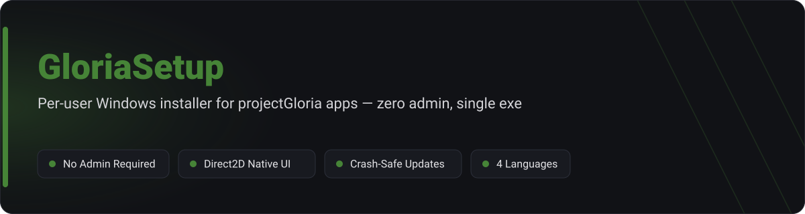
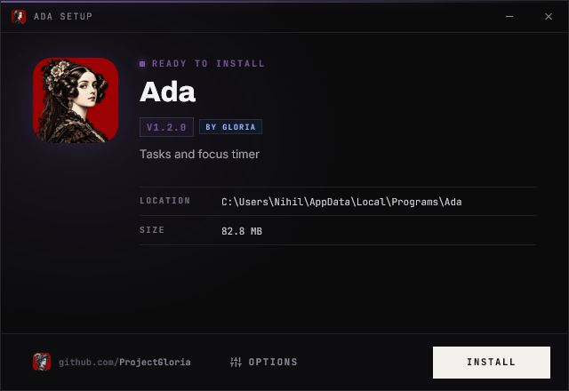
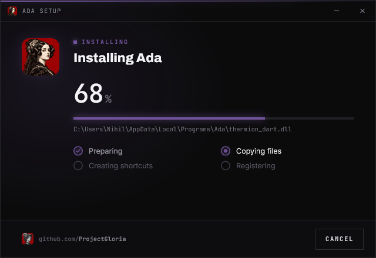
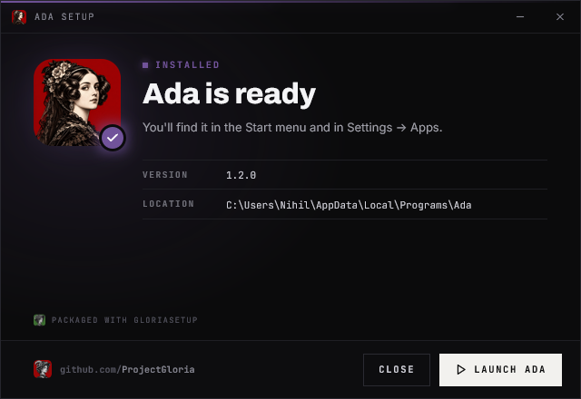
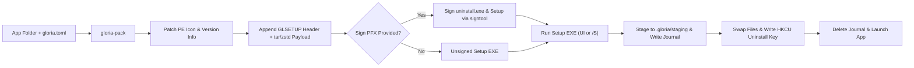

<div align="center">


# GloriaSetup

Per-user Windows installer stub, packager CLI, and GitHub Action for projectGloria apps — no admin rights, single executable.


<br /><br />



<br /><br />

[Features](#features) • [Screenshots](#screenshots) • [How it works](#how-it-works) • [Installation](#installation) • [Usage](#usage) • [Configuration](#configuration) • [Troubleshooting](#troubleshooting)

</div>

## About

GloriaSetup is a Windows x64 installer toolchain written in Rust (`windows` 0.62) consisting of a native Win32/Direct2D setup stub (`gloria-stub`), a packager CLI (`gloria-pack`), a shared core library (`gloria-core`), an npm distribution (`gloria-setup`), and a composite GitHub Action (`action.yml`). It packages an application directory and a `gloria.toml` manifest into a single zstd-compressed `<Name>_<version>_x64-setup.exe` that installs per-user under `%LOCALAPPDATA%\Programs\<App>` and registers only under `HKCU` with no administrator privileges required (elevation is requested only when migrating a legacy all-users `HKLM` installation). Full architecture details are documented in [docs/design.md](docs/design.md).

## Features

- **Per-user installs without UAC** — Installs to `%LOCALAPPDATA%\Programs\<Name>` (or a validated custom folder) and writes uninstall metadata exclusively to `HKCU\Software\Microsoft\Windows\CurrentVersion\Uninstall\projectGloria.<id>` for Windows Settings and GloriaLauncher.
- **Native Win32 + Direct2D UI** — Renders a 640×440 frameless dark-mode installer using Direct2D/DirectWrite with software-renderer (WARP) support, per-app accent theming, and built-in translations for English (`en`), French (`fr`), Spanish (`es`), and Turkish (`tr`).
- **Crash-safe journaled commits** — Stages payloads into `<dir>\.gloria\staging`, records a commit journal before swapping files with `.gloria\backup`, and automatically rolls back interrupted installs or updates on the next run.
- **Safe updates, downgrades, and uninstalls** — Removes only files tracked in `install-manifest.json`, preserves user data in `data_folders` unless `/PURGE` or the off-by-default data removal checkbox is selected, refuses silent downgrades without `/ALLOWDOWNGRADE`, and self-deletes `uninstall.exe` via a `%TEMP%` trampoline.
- **Legacy migration and optional WebView2** — Detects prior NSIS/MSI/Inno installs, backs up `data_folders` before running legacy uninstallers, and optionally bundles `MicrosoftEdgeWebview2Setup.exe` to run only when WebView2 is missing.
- **Resource patching and Authenticode signing** — Replaces the stub's PE icons and version info with the target app's own assets, appends the `GLSETUP\0` tar/zstd payload, and signs `uninstall.exe` and the final setup via `signtool.exe`.
- **CI and npm distribution** — Ships as a composite GitHub Action (`action.yml`) that downloads checksum-verified binaries and attaches setups to GitHub Releases, plus the `gloria-setup` npm package with CLI and JS/TS API (`pack`, `inspect`, `packPath`, `stubPath`).

## Screenshots

<p align="center">
  
  <br />
  <em>Welcome screen displaying the packaged app's icon, version badge, install location, unpacked size, and options toggle.</em>
</p>

<p align="center">
  
  <br />
  <em>Installation progress screen showing percentage, active file path, four-stage checklist, and cancel control.</em>
</p>

<p align="center">
  
  <br />
  <em>Completion screen confirming installed version and location with direct launch and close actions.</em>
</p>

## How it works



## Installation

### Via npm (Windows x64)

```powershell
npm install --save-dev gloria-setup
```

The `gloria-setup` package bundles `gloria-pack.exe` and `gloria-stub.exe` and exposes `npx gloria-pack` alongside a JS/TS API (`pack`, `inspect`, `packPath`, `stubPath`).

### From source

Requires Rust 1.80+ (`x86_64-pc-windows-msvc`) on Windows 10/11:

```powershell
cargo build --release -p gloria-stub -p gloria-pack
cargo test --workspace
```

### In GitHub Actions

```yaml
jobs:
  setup:
    runs-on: windows-latest
    permissions:
      contents: write
    steps:
      - uses: actions/checkout@v4
      # Build your app into app-dist\
      - uses: projectGloria/GloriaSetup@v0.2.0
        with:
          app-dir: app-dist
          manifest: gloria.toml
          certificate: ${{ secrets.WINDOWS_PFX_BASE64 }}
          certificate-password: ${{ secrets.WINDOWS_PFX_PASSWORD }}
```

When run on a tag (for example `v1.2.0`), the action packs version `1.2.0` and attaches `<Name>_1.2.0_x64-setup.exe` to that tag's existing GitHub Release. At a release tag it downloads `gloria-pack.exe` and `gloria-stub.exe` and verifies `SHA256SUMS.txt`; at a branch or commit it builds them from source.

## Usage

### Pack an application

```powershell
target\release\gloria-pack.exe `
  --app path\to\built\app `
  --manifest path\to\gloria.toml `
  --version 1.2.0 `
  --stub target\release\gloria-stub.exe `
  --out dist
```

Inspect the icons, version metadata, and payload summary of any built installer:

```powershell
target\release\gloria-pack.exe --inspect dist\MyApp_1.2.0_x64-setup.exe
```

### Sign an installer

Pass the certificate password through `GLORIA_SIGN_PASSWORD` (never as a CLI argument):

```powershell
$env:GLORIA_SIGN_PASSWORD = '<pfx password>'
target\release\gloria-pack.exe `
  --app path\to\built\app `
  --manifest path\to\gloria.toml `
  --version 1.2.0 `
  --sign-pfx C:\Users\you\cert.pfx `
  --timestamp-url http://timestamp.digicert.com
```

`gloria-pack` signs `uninstall.exe` before archiving it, signs the final setup after appending the payload, and verifies that the signed setup still locates its payload. `signtool.exe` is resolved from `PATH`, the newest Windows SDK, or `--signtool`.

### Setup command-line flags

Run setups with slash flags from PowerShell or `cmd.exe`:

```powershell
(Start-Process .\MyApp_1.2.0_x64-setup.exe -ArgumentList '/S /D=C:\Users\you\Apps\MyApp' -Wait -PassThru).ExitCode
```

| Flag | Behavior |
| --- | --- |
| `/S` | Silent install or uninstall |
| `/D=<path>` | Custom install folder (must be the last argument; spaces need no quotes) |
| `/PURGE` | Also delete configured `data_folders` during silent uninstall or clean reinstall |
| `/ALLOWDOWNGRADE` | Permit installing an older version during a silent install |
| `/RELAUNCH` | Start the installed app after a silent install completes |
| `--dry-run` | Log every planned file, shortcut, and registry action without modifying disk or registry |

**Exit codes:** `0` success, `1` general error, `2` downgrade refused, `3` running app could not be closed or files locked, `4` UAC elevation declined during legacy migration, `5` WebView2 bootstrapper failed, `6` invalid CLI arguments or disallowed install path.

### Preview UI and local testing

Preview all screens and languages without installing anything:

```powershell
target\release\gloria-stub.exe --preview
target\release\gloria-stub.exe --preview --page uninstall --lang tr
target\release\gloria-stub.exe --preview --manifest examples\dummy\gloria.toml --icon examples\dummy\icons\dummy-a.ico
target\release\gloria-stub.exe --screenshot out\shots
```

Build the bundled dummy installers (`0.1.0` and `0.2.0`) or launch them inside Windows Sandbox:

```powershell
powershell -ExecutionPolicy Bypass -File examples\dummy\pack.ps1
powershell -ExecutionPolicy Bypass -File sandbox\run.ps1
```

## Configuration

### App manifest (`gloria.toml`)

```toml
id = "GloriaDummy"
name = "GloriaSetup Dummy"
version = "0.1.0"
main_exe = "dummy.exe"
icon = "icons/dummy-a.ico"
accent = "#5b8def"
description = "Test app for GloriaSetup"
needs_webview2 = false
data_folders = ['%APPDATA%\com.gloria.dummy']
legacy_names = []
```

| Field | Required | Description |
| --- | --- | --- |
| `id` | Yes | 1–64 chars (`A–Z`, `a–z`, `0–9`, `.`, `_`, `-`, not starting with `.`); used for `projectGloria.<id>` registry key |
| `name` | Yes | Single-line display name shown in the UI, Start Menu, and Settings → Apps |
| `version` | Yes | SemVer string without leading `v` (overridable via `--version`) |
| `main_exe` | Yes | Relative path to the main `.exe` inside `--app` (cannot start with `unins`) |
| `icon` | No | Path to `.ico` or `.png` (overridable via `--icon`; use `--allow-default-icon` for test builds) |
| `accent` | No | `#rrggbb` UI accent color (defaults to `#9a9aa6`) |
| `description` | No | Short subtitle shown on the welcome screen |
| `needs_webview2` | No | When `true`, checks for WebView2 Runtime and runs the bundled `--webview2-bootstrapper` if missing |
| `data_folders` | No | User data paths under `%APPDATA%\`, `%LOCALAPPDATA%\`, or `%USERPROFILE%\` backed up on migration and deleted only on purge |
| `legacy_names` | No | Legacy `DisplayName` entries to detect and migrate when `projectGloria.<id>` is not yet installed |
| `app_user_model_id` | No | Optional Windows AppUserModelID written to the Start Menu shortcut |
| `context_menu` | No | Optional per-user Explorer context-menu label for folders, backgrounds, and drives |

### GitHub Action inputs and outputs

Key inputs in [action.yml](action.yml): `app-dir` (required), `manifest`, `version`, `icon`, `webview2-bootstrapper`, `out-dir` (default `dist`), `certificate`, `certificate-password`, `timestamp-url` (default `http://timestamp.digicert.com`), `upload` (`auto`/`true`/`false`), `release-tag`, `gloria-setup-version`, `token`.
Outputs: `setup-path`, `setup-name`, `signed`.

## Troubleshooting

- **Slash flags fail in Git Bash (`exit code 6`):** MSYS/Git Bash rewrites `/S` into a POSIX path. Run setups with flags from PowerShell (`Start-Process ... -ArgumentList '/S' -Wait -PassThru`) or `cmd.exe`.
- **Disallowed install directory (`exit code 6`):** GloriaSetup refuses `%TEMP%`, `Program Files`, `Windows`, and overlapping `data_folders`. Choose a per-user directory such as `C:\Users\you\AppData\Local\Programs\<App>`.
- **Running application or locked files (`exit code 3`):** Close the target application before retrying. In silent mode (`/S`), the stub waits a grace period and attempts to force-close matching processes before returning `3`.
- **WebView2 installation fails (`exit code 5`):** For `needs_webview2 = true` apps, bundle `MicrosoftEdgeWebview2Setup.exe` via `--webview2-bootstrapper`. If the target machine lacks WebView2 and has no network access, the bootstrapper fails and nothing is left installed.
- **SmartScreen warning on unsigned setups:** If `--sign-pfx` / `certificate` is omitted, the generated `.exe` is unsigned and Windows SmartScreen may warn until it builds reputation or is signed with a trusted certificate.
- **Inspecting run logs:** Every real install, update, uninstall, or `--dry-run` writes a detailed log to `%TEMP%\GloriaSetup-<id>-<timestamp>.log`.
